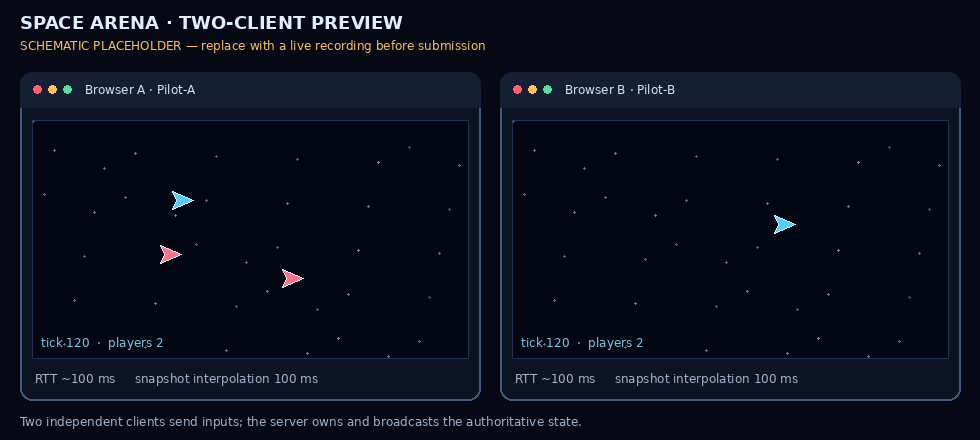

# Space Arena — JavaScript Semester Project

[](https://github.com/USERNAME/REPOSITORY/actions/workflows/ci.yml)

<!-- Replace USERNAME/REPOSITORY with the owner and repository name after publishing. -->

Labs 01–07 build one browser multiplayer game step by step. The client is in `client/`, the Node.js server in `server/`, and **the deterministic simulation and wire codecs shared by both runtimes are in `shared/`**.

## Lab 05 — Server-authoritative multiplayer, prediction and binary protocol

### What changed in Lab 05

- The Node.js server owns the world simulation. Clients send only `{ seq, throttle, turn, fire }`; the server rejects input objects with extra properties such as `x`, `y`, `position` or `coordinates`.
- The simulation is in `shared/simulation.ts`. It contains no DOM access, Node imports, `Date.now()` or `Math.random()`. Both Node and the browser import the same integration functions. The asteroid field uses a seeded PRNG initialized from a deterministic room seed.
- Every room runs at **30 fixed simulation steps/s** (`dt = 1/30`). The scheduler uses a monotonic `performance.now()` deadline and recursive `setTimeout`, not `setInterval`. If the process falls too far behind it caps catch-up work instead of running an unbounded spiral.
- Every input has a monotonically increasing `seq`. Each personalized snapshot includes `ackSeq`, the last input sequence applied by the server for that player.
- The client has a baseline mode (prediction disabled) and client prediction + reconciliation. When prediction is enabled, it integrates the player's controls immediately; after a snapshot it replaces its state with the authoritative state and replays inputs newer than `ackSeq`. The remaining visual offset decays smoothly; the exponential correction leaves about 5% of the offset after roughly 100 ms.
- Other ships are rendered from snapshots about **100 ms in the past**, interpolated between adjacent snapshots. The local ship's projectiles are created immediately on the client; remote projectiles come from the server state.
- A network diagnostics panel displays RTT, snapshot age, traffic in bytes/s, unacknowledged input queue length, correction distance, dropped packets and protocol mode.
- Artificial network conditions can be changed while playing: simulated RTT, jitter and packet loss. The configured RTT is split between client-to-server and server-to-client delay. A seeded client PRNG derived from the server-provided room seed and player ID makes the artificial delay/jitter/loss demonstration repeatable.
- The protocol selector supports binary and JSON modes. JSON is retained as a comparison baseline. An opt-in fault-injection checkbox adds `Math.random()` noise only to the client prediction after integration; correction distance grows, and unchecking it restores deterministic prediction without contaminating the shared server simulation.

## Gameplay systems kept in the Lab 05 authoritative simulation

- **Enemy ships:** each room spawns red-tinted enemy ships from its `enemies` room setting. Their deterministic AI steers toward the nearest live player and fires server-side bullets; enemy health, projectiles and respawn state are carried in snapshots.
- **Pickups:** three seeded green repair pickups are spawned by default. Their collision radius is deliberately generous to match the visible sprite. The server detects circle-circle overlap (including across wrapped arena edges), heals up to 35 HP, deactivates the pickup for five seconds, and then respawns it. A full-health player still collects it and receives a small score bonus instead of passing through invisibly.
- **Asteroid destruction:** asteroids have visible HP bars and do not have a time-to-live. Mere contact with a ship and enemy fire do not destroy asteroids; player projectiles damage them. A large asteroid takes two standard hits and splits into two smaller fragments; fragments have their own HP and disappear only after the player shoots them.
- **Homing fire:** every fifth shot homes deterministically toward the nearest valid target. Homing is part of the shared simulation, and the binary frame carries the homing flag so JSON and binary mode preserve the same gameplay.
- **Effects/audio:** the client renders local cosmetic particles when an asteroid or ship is destroyed and emits the existing Lab 03 Web Audio events for firing, impacts, pickups, explosions and respawns. Cosmetic particles never alter server state.

## Project structure

```text
.
├── client/
│   ├── public/assets/             # Existing Lab 03 sprites and audio
│   ├── src/
│   │   ├── main.ts                # Typed app entry and lobby wiring
│   │   ├── network-game.ts        # Prediction, reconciliation, interpolation, netgraph
│   │   ├── socket-client.ts       # Reconnecting WebSocket wrapper + binary frames
│   │   └── ...                    # Typed loading, audio, HUD and socket modules
│   ├── index.html
│   └── vite.config.ts             # /api and /ws proxy to Node
├── server/
│   ├── src/
│   │   ├── rooms.ts               # Room state and target-time 30 Hz scheduler
│   │   ├── ws-server.ts           # Input validation and snapshots
│   │   └── ...                    # Labs 04 HTTP, stream logging and config
│   ├── examples/shared-smoke.ts   # Test the pure simulation and codecs
│   └── bench/protocol-size.ts     # JSON vs binary payload measurement
├── shared/
│   ├── simulation.ts              # Same deterministic simulation in Node and browser
│   ├── protocol.ts                # ArrayBuffer + DataView encoders/decoders
│   ├── types.ts                   # Branded IDs, inputs and discriminated snapshot entities
│   ├── schemas.ts                 # Zod runtime validation and inferred message types
│   ├── vector2.ts                 # Readonly, immutable vector value
│   └── package.json
├── docs/
│   ├── rss-backpressure.svg
│   └── two-window-demo.gif        # Schematic placeholder; replace with real recording
├── tsconfig.json                  # strict TS + noUncheckedIndexedAccess
└── .github/workflows/ci.yml       # typecheck + deterministic test + build
```

## Run locally

Use a current Node.js LTS release. At the repository root:

```bash
npm install
npm run dev
```

This starts Vite and the Node server. Open `http://localhost:5173/`. Click through the asset-loading step and choose a room in the lobby. Open a **second browser window** at the same address, enter a different name and join the **same room**. Use WASD/arrow keys to steer and Space to fire.

Useful commands from the root:

```bash
npm run typecheck
npm run test:shared
npm run bench:protocol
npm run lint
npm run build
```

Production flow:

```bash
npm run build
npm start
```

## Input and snapshot rules

The client never sends its coordinates. For example, an input message is:

```json
{ "type": "input", "seq": 42, "throttle": 1, "turn": -1, "fire": true }
```

The server validates type, shape, sequence and control ranges. The `shared` module integrates players, enemy AI, homing bullets, asteroids and pickups using the server's fixed `dt`. A server snapshot includes players, enemies, bullets, asteroids, pickups and `ackSeq`. Coordinates are never accepted from the client.

### Prediction and reconciliation

1. The client samples keyboard controls at 30 Hz, increments `seq`, saves that input in a pending-input history and sends it to the server.
2. With **prediction enabled**, the client runs `integrateShip()` immediately so the local ship does not wait for a round trip.
3. When a snapshot arrives, the client measures RTT from the acknowledged input's send time, installs the server's local-ship state, removes inputs with `seq <= ackSeq`, and replays the rest in order.
4. The difference between the previous displayed position and the replayed position becomes a correction offset. That offset fades over approximately 100 ms rather than snapping instantly.
5. If prediction is unchecked, the local ship is drawn from snapshots instead. Set simulated RTT to 100 ms and compare both modes to see the input delay directly.

### Remote interpolation

The client stores a short buffer of timestamped snapshots. To draw remote ships, it targets a render time 100 ms behind the latest local receive time and interpolates positions and angles between the two snapshots surrounding that time. A small buffer is intentional: it gives the next snapshot time to arrive under typical jitter. More interpolation delay looks smoother but makes remote motion older; less delay is more responsive but more likely to extrapolate or visibly step when packets arrive late.

## Binary protocol: `ArrayBuffer` and `DataView`

All multi-byte fields are **little-endian**. The current version byte is `3`; JSON snapshot records include a literal `kind` discriminator (`ship`, `enemy`, `bullet`, `asteroid`, `pickup`). In binary, the section/count identifies the record kind and the decoder restores that `kind` field. The second byte is the frame type (`1` input, `2` snapshot). A signed 16-bit angle maps `[-π, π]` to `[-32767, 32767]`.

**Input frame (9 bytes)**

| Offset | Field | Encoding |
|---:|---|---|
| 0 | version | `uint8` |
| 1 | type = input | `uint8` |
| 2 | sequence | `uint32`, little-endian |
| 6 | throttle | `int8`, scaled by 127 |
| 7 | turn | `int8`, scaled by 127 |
| 8 | flags; bit 0 = fire | `uint8` |

**Snapshot frame (23-byte header, then fixed-size records)**

| Offset | Field | Encoding |
|---:|---|---|
| 0 | version | `uint8` |
| 1 | type = snapshot | `uint8` |
| 2 | server tick | `uint32`, little-endian |
| 6 | acknowledged input sequence | `uint32`, little-endian |
| 10 | arena width | `uint16`, little-endian |
| 12 | arena height | `uint16`, little-endian |
| 14 | server timestamp for age telemetry | `uint32`, little-endian |
| 18 | player count | `uint8` |
| 19 | bullet count | `uint8` |
| 20 | asteroid count | `uint8` |
| 21 | pickup count | `uint8` |
| 22 | enemy count | `uint8` |

After the header: player and enemy records are 30 bytes each; bullet records are 27 bytes; asteroid records are 30 bytes; pickup records are 15 bytes. Ship records include hp/maxHp, score, cooldown and shots fired. Bullets include velocity, TTL and the homing flag. Asteroids include velocity, angle, angular velocity, radius and hp/maxHp. Pickups include position, radius and active state. `shared/protocol.ts` checks the version/type and verifies that the frame length exactly matches the counts in the header. Server simulation state never depends on the binary representation; JSON and binary carry the same snapshot information.

## JSON vs binary measurement

Run `npm run bench:protocol` to repeat the comparison on a deterministic sample (2 players, 2 enemy ships, 12 asteroids, 3 pickups and 2 bullets). One run of the included sample produced:

| Payload | JSON | Binary | Reduction |
|---|---:|---:|---:|
| One input | 62 bytes | 9 bytes | 85.5% |
| One snapshot sample (with kind-discriminated entities) | 4,472 bytes | 602 bytes | 86.5% |

These numbers are for this specific sample and field set, not a promise that every possible game state has the same ratio. JSON remains available via the **Network protocol** selector in the lobby so the two representations can be compared in the same game.

## Network test procedure and GIF

1. Run `npm run dev` and open `http://localhost:5173/` in two separate browser windows (or one regular and one private window).
2. Enable audio/load assets in both, choose different player names, choose the same room, and click **Join** in both.
3. In both windows select binary protocol for the default test. Move and fire; the other ship should be visible in the same arena.
4. Set simulated RTT to 100 ms. Turn prediction off and move to demonstrate delayed control response; turn it back on and observe immediate local movement plus reconciliation. Enable “Inject Math.random() drift” briefly: correction distance should grow because the client estimate no longer follows the shared deterministic integration. Disable it after observing the effect. Try jitter 60 ms and packet loss 5–10% to see input queue and dropped-packet counters respond.
5. Record both live windows with a screen recorder such as ScreenToGif, and replace `docs/two-window-demo.gif` with that real recording before final submission.



The included GIF is intentionally marked as a **schematic placeholder**, not a recording of a running browser session. The submitted README should contain your own live two-window recording after you perform the steps above.

## Experiment note: latency, divergence, cheating and interpolation

**Latency and prediction.** Without prediction, local controls affect the displayed ship only when a server snapshot returns, so the perceived delay grows with network round-trip time. Prediction applies the same fixed-step integration to local input immediately. It feels more responsive, but the client is only estimating: the server remains authoritative. A snapshot can disagree with the estimate because of latency, packet loss, input quantization, a different acknowledged sequence or an implementation bug. Reconciliation replaces the local estimate with the authoritative state and replays only unacknowledged inputs; a smoothed correction hides small differences without allowing the client to decide the official position.

**Determinism and divergence.** `shared/simulation.ts` is deliberately free of `Math.random()` and `Date.now()`. Arena randomness is produced from a seed generated by the server and sent with the join response, and simulation advances only in fixed 1/30-second steps. The optional `Math.random()` fault is isolated to the client-side prediction view and must be unchecked for normal play. Both environments use the same integration function and quantized binary controls. This reduces divergence; it does not make a client trusted. Rendering, network arrival times and prediction correction may still differ, so the server's snapshot is the final truth.

**Cheats.** Accepting coordinates from the client would allow a modified client to teleport, move faster, ignore collisions or claim hits that did not happen. The server therefore accepts controls only and calculates positions, bullets, hits and score itself. The client can lie about its local display, but it cannot make the server accept an arbitrary position through the input protocol. Server-side rate limits and bounds checks remain necessary in a production game.

**Interpolation choice.** Remote ships are rendered 100 ms behind the latest received snapshot. This gives a buffer of about three 30 Hz ticks for normal jitter, allowing motion to be interpolated instead of jumping from snapshot to snapshot. A larger buffer can look smoother on unstable links but makes opponents visibly older; a smaller buffer looks more current but increases visible stepping when snapshots arrive late. The selected 100 ms is a deliberate compromise for this lab and can be changed via `INTERPOLATION_DELAY_MS` in `client/src/network-game.ts`.

## Labs 01–05 retained

- **Lab 01:** Vite, modules, Canvas/DPR, closure-based input, fixed timestep, interpolation, HUD and event-loop experiments.
- **Lab 02:** `Vector2`, `Entity`, `Ship extends Entity`, `Map` world, bullets, collisions, `this`, prototype chain and composition.
- **Lab 03:** Promise-based asset pipeline, cancellation/retry, loading screen, lobby, Web Audio, event bus and microtask puzzles.
- **Lab 04:** Node HTTP, `EventEmitter` rooms, WebSocket chat, input validation, streams/backpressure and streamed match logs.
- **Lab 05:** Server-authoritative deterministic simulation, prediction/reconciliation, remote interpolation, JSON/binary protocols, network diagnostics, enemy ships, pickups, asteroid fragments and audio effects.

## Submission — Lab 05

After verifying both windows and completing your live GIF, from the repository root:

```bash
git add .
git commit -m "lab-05: authoritative simulation prediction and binary protocol"
git push origin main
git tag lab-05
git push origin lab-05
```

Submit the URL of the same public GitHub repository used for Labs 01–05. The required new tag is `lab-05`.


## Lab 06 — TypeScript for protocol and simulation

Lab 06 keeps the existing gameplay and converts the shared simulation/protocol plus the active client and server paths to TypeScript. It does not replace the Canvas renderer or add a UI framework: the goal is to make the network boundary and deterministic simulation safer while preserving the Lab 1–5 behaviour.

### What is typed

- `shared/types.ts` defines the shared contracts for controls, ships, bullets, asteroids, pickups and snapshots. Vector-like inputs use `readonly` coordinates, so callers cannot accidentally mutate a value through the interface.
- `EntityId`, `StepNumber` and `InputSeq` are branded numbers. They are all numbers at runtime, but TypeScript rejects accidentally passing an input sequence where an entity ID is required. The three brand constructors share one documented generic assertion helper. There are three type assertions in active client/shared/server runtime source: the brand helper, the `CustomEvent<T>` event-bus boundary and the Worker-global boundary; each has a short nearby comment.
- Messages form discriminated unions using the `type` field (`input`, `snapshot`, `joined`, `chat`, and so on); simulation entities/snapshots have distinct shapes and the shared entity-kind union. Switch statements that need to handle all variants use `assertNever`/a `never` assignment so adding a new variant triggers a compile-time error until it is handled.
- `shared/schemas.ts` uses Zod schemas as the source of runtime validation and inferred types. The WebSocket entry point accepts untrusted data as `unknown`, checks JSON before dispatch, and closes/logs malformed messages rather than assuming that TypeScript types validate external data.
- `shared/protocol.ts` checks the binary version, exact packet length and field ranges before reading a frame. TypeScript does not validate a byte stream at runtime; the decoder and Zod schemas do that explicitly.
- `server/src/config.ts` validates environment variables using Zod. Error handlers keep caught errors typed as `unknown` and convert them to safe log messages.

### TypeScript errors found and fixed during migration

1. An unbranded `number` could be supplied as either an entity ID or an input sequence. The branded types now make those accidental substitutions a compile-time error.
2. Snapshot/wire data do not contain every internal simulation field. Snapshot types now distinguish wire fields from internal-only state instead of treating a partial network snapshot as a full mutable simulation entity.
3. `JSON.parse`, WebSocket payloads and environment variables were previously easy to use as if they had trusted shapes. They now enter the program as `unknown`/environment strings, then pass Zod or binary validation before the simulation consumes them.
4. With `noUncheckedIndexedAccess`, values read from arrays and maps may be absent. The active runtime paths explicitly handle missing entities/snapshots rather than assuming indexes always exist.
5. The discriminated message switch is exhaustive. If a new protocol message is added to the union, TypeScript will point out an unhandled variant instead of silently letting it fall through.

### Three types, in simple words

- **`EntityId` (branded type):** a normal number used specifically as a game entity ID. It helps stop mixing an ID with a tick number or a message sequence.
- **`InputMessage` / `SnapshotMessage` (discriminated message types):** the `type` field tells TypeScript which fields belong to the current message. An input has controls and a sequence; a snapshot has the server state.
- **`Readonly` fields:** a value can be read by the caller, but not edited through that type. For example, a function receiving a readonly vector cannot accidentally change its `x` or `y` as a side effect.

### Why no UI framework was added

The lab allows a framework for the lobby/HUD, but it is optional. The project keeps vanilla TypeScript/DOM for the lobby and HUD and Canvas 2D for the arena so the previous event-loop, rendering, loading and network code remains easy to trace. Introducing React/Vue/Svelte here would add a second migration without improving the learning target: strict typing of simulation, protocol, runtime validation and networking.

### Commands and CI

From the repository root:

```bash
npm install
npm run typecheck
npm run test:shared
npm run bench:protocol
npm run build
npm run lint
```

`npm run typecheck` runs `tsc --noEmit -p tsconfig.json` with `strict`, `noUncheckedIndexedAccess`, `noImplicitOverride`, `useUnknownInCatchVariables` and `verbatimModuleSyntax`. The GitHub Actions workflow in `.github/workflows/ci.yml` installs dependencies and runs typecheck, the deterministic/shared simulation test and the client build on each push and pull request.

The determinism test is `server/examples/shared-smoke.ts`. It runs two simulations with the same seed and inputs and asserts that ships, enemies, bullets, asteroids and pickups finish in exactly the same state. It also checks pickup collision, asteroid splitting, enemy movement/fire and binary input/snapshot round trips.

## Submission — Lab 06

Keep this change in the **same public GitHub repository** used for Labs 01–05. After `npm run typecheck`, `npm run test:shared` and `npm run build` pass:

```bash
git add .
git commit -m "lab-06: migrate simulation and protocol to TypeScript"
git push origin main
git tag lab-06
git push origin lab-06
```

The submission is the URL of the same public repository with tags `lab-01` through `lab-06`. The old tags are historical checkpoints and should not be moved.


## Lab 07 — V8, memory, profiling and automated tests

Lab 07 keeps the Lab 01–06 gameplay and network protocol. It adds automated correctness tests, browser-to-browser end-to-end coverage, performance telemetry, object reuse and load-test tools. Do not remove the earlier lab sections or move the historical Git tags.

### Test layers

- **Vitest** runs tests for `shared/`, `client/` and `server/`. The suite contains more than 60 named test cases. `shared/tests/protocol.property.test.ts` has six `fast-check` properties for input round-trips (including int8 quantization), snapshot angle round-trips (including Int16 quantization), exact snapshot frame length, malformed/truncated buffers, arena-bound invariants and Zod message validation. The configured shared-code line and statement coverage gates are at least 85%.
- **Determinism** runs the exact same `shared/simulation.ts` code in both Node and the browser bundle. Equal seeds and equal input sequences must result in equal state; the smoke test and unit tests check this invariant. No `Math.random()` or wall-clock time is used by the shared simulation.
- **Playwright** launches two independent Chromium browser processes, joins both to one room, verifies that the second browser receives movement for the first player's ship, and checks that room chat arrives.
- **GitHub Actions** runs typecheck, lint, Vitest with coverage thresholds, shared determinism smoke test, client build and the two-browser Playwright scenario for every push and pull request. The badge at the top of this README is the workflow status; replace `USERNAME/REPOSITORY` with the actual GitHub path after publishing. CI also installs Chromium before the Playwright job, so the same two-browser check runs on pushes and pull requests.

Commands from the repository root:

```bash
npm install
npm run typecheck
npm run lint
npm test
npm run test:coverage
npm run test:shared
npm run build
npm run test:e2e
npm run test:all
```

`npm run test:all` executes the full local quality sequence. `npm run test:coverage` writes an HTML report to `coverage/`; the CI gate requires at least 85% shared-code lines and statements. The six property tests use hundreds of generated inputs in addition to their normal examples.

### V8, hidden classes and inline caches

V8 first parses JavaScript and produces bytecode for its interpreter. Frequently executed functions can be optimized by the JIT compiler. Optimizations rely on assumptions about types and object shapes; when those assumptions stop holding, V8 may deoptimize a function and return to a less specialized execution path. V8 uses hidden classes (also called Maps) to describe object layouts, and inline caches remember property-access information for previously seen shapes.

For this reason, the hot game objects keep a consistent property layout: ships and bullets are created with the same fields in the same order, and pooling resets/reuses those objects rather than repeatedly changing their shape. Run the small diagnostic with:

```bash
npm run v8:trace
```

The command uses Node/V8 `--trace-opt` and `--trace-deopt` output. Its timings are illustrative only; use Chrome DevTools on the actual browser game for frame profiling.

### Memory and object reuse

- Server simulation bullets are recycled through `SimulationState.bulletPool` (bounded at 512 entries). Expired and hit bullets return to the pool; firing reinitializes an existing object when possible.
- The client reuses predicted local bullets and visual explosion particles. The performance HUD reports pool reuse counts and active counts.
- The frame-time monitor stores samples in a fixed-size `Float64Array` ring buffer; it does not shift or allocate a new vector/record on each animation frame. Percentiles are calculated only when the summary is requested. The game loop itself does not create `Vector2` objects per frame; the simulation's hot integration path uses numeric coordinates.
- The browser performance panel displays frame p50/p95/p99 and GC event totals when the browser exposes `PerformanceObserver` GC entries. If GC entries are unsupported, use the GC markers in Chrome DevTools Performance recordings; a zero counter alone does not prove that no GC occurred.

### Recording a 30-second eight-bot profile

1. Start the app from the repository root with `npm run dev`.
2. In a second terminal set the bot run to eight clients and 30 seconds, then start it:

   **PowerShell**
   ```powershell
   $env:BOT_COUNT = '8'
   $env:DURATION_MS = '30000'
   $env:ROOM_ID = 'lab7-eight-bot-recording'
   npm run bots:record
   ```

3. The script creates a temporary room and connects eight bots. Open the browser lobby during the 30-second run and join `lab7-eight-bot-recording` with a human player.
4. Open Chrome DevTools → **Performance**, start recording, leave it running for the same 30-second window, then stop. Record frame p50/p95/p99 from the in-game performance panel and GC pauses from the DevTools timeline.
5. In the Performance panel inspect **Bottom-up** / **Heaviest stack** and the allocation view. Record which function or entity creates the most short-lived objects. Save screenshots of the flame chart before and after optimization to `docs/flame-before.png` and `docs/flame-after.png`, and add them below. Do not write estimated numbers as measured results.

**Before/after evidence — replace these lines with your real Chrome DevTools captures:**

- Before optimization: `docs/flame-before.png`
- After optimization: `docs/flame-after.png`

The target is p99 frame time below **16.7 ms** and no long GC pause during the recording. These are targets, not hard-coded results: the actual measurements depend on the computer, browser, display refresh rate and bot load. The current code pools bullets/particles and uses a fixed-size frame sample buffer; compare the real DevTools profiles before claiming that the target was reached.

### Web Worker experiment

After joining a room, open the network/performance panel and press **Compare Main Thread vs Web Worker**. The experiment warms up a module Worker, processes a representative 1,800-sample frame-time batch on the main thread and in the Worker, and compares elapsed time including message/transfer overhead. A Worker is kept only if its round-trip is faster; otherwise it is terminated and the computation remains on the main thread. When retained, it also processes the large frame-time sample batches used by the live HUD (the monitor copies its ring buffer only once per second, not per frame). The decision is machine- and browser-dependent, so record the displayed measurements and conclusion in the report.

### Server load test: 8, 32, 64 and 128 clients

Keep the app/server running in one terminal, then run in another:

```bash
npm run loadtest
```

By default the script connects 8, 32, 64 and 128 WebSocket bots one load at a time. Every bot sends the same `{ seq, throttle, turn, fire }` input shape as a human client; no bot sends coordinates. The report prints room step p95/p99, the most recent maximum step time and the number of steps longer than **33.33 ms**. To use a shorter/longer measurement, set `DURATION_MS`; to change the client counts, set `CLIENT_COUNTS`.

The current collision code retains the straightforward all-pairs checks as the baseline. Only replace them with a spatial hash if the measured room step p99 or over-budget count shows that collision work is the bottleneck. If a run crosses 33.33 ms, profile the collision loops first, add a deterministic spatial broadphase, then rerun exactly the same load test and document before/after p95/p99. No spatial-hash speedup is claimed without that measurement.

### Required Lab 07 evidence to fill in after running locally

| Measurement | Result from your machine |
|---|---:|
| Vitest named test cases | 149+ (including table-driven cases) |
| Shared line coverage | TODO — copy from `npm run test:coverage` |
| Frame p50 / p95 / p99 (8 bots, 30 s) | TODO — copy from browser HUD / DevTools |
| GC pause count / total pause | TODO — Chrome DevTools Performance |
| Main object-allocation source | TODO — DevTools Bottom-up / allocation profile |
| Worker main-thread / round-trip time | TODO — Worker experiment output |
| Server step p99 at 8 / 32 / 64 / 128 clients | TODO — `npm run loadtest` |
| First client count above 33.33 ms, if any | TODO — load-test output |

## Submission — Lab 07

Keep this work in the same public repository used for Labs 01–06. Before committing, confirm `npm run typecheck`, `npm run lint`, `npm run test:coverage`, `npm run test:shared`, `npm run build` and `npm run test:e2e` pass. Add the real flame-chart screenshots and local measurements to README. Then create the new tag:

```bash
git add .
git commit -m "lab-07: tests profiling and memory optimizations"
git push origin main
git tag lab-07
git push origin lab-07
```

The submission is the URL of the same public GitHub repository with historical tags `lab-01` through `lab-07`. Do not delete or move the earlier lab tags.
