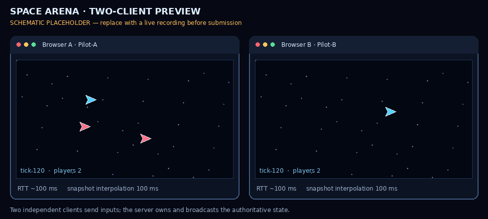

# Space Arena — JavaScript Semester Project

Labs 01–05 build one browser multiplayer game step by step. The client is in `client/`, the Node.js server in `server/`, and **the deterministic simulation and wire codecs shared by both runtimes are in `shared/`**.

## Lab 05 — Server-authoritative multiplayer, prediction and binary protocol

### What changed in Lab 05

- The Node.js server owns the world simulation. Clients send only `{ seq, throttle, turn, fire }`; the server rejects input objects with extra properties such as `x`, `y`, `position` or `coordinates`.
- The simulation is in `shared/simulation.js`. It contains no DOM access, Node imports, `Date.now()` or `Math.random()`. Both Node and the browser import the same integration functions. The asteroid field uses a seeded PRNG initialized from a deterministic room seed.
- Every room runs at **30 fixed simulation steps/s** (`dt = 1/30`). The scheduler uses a monotonic `performance.now()` deadline and recursive `setTimeout`, not `setInterval`. If the process falls too far behind it caps catch-up work instead of running an unbounded spiral.
- Every input has a monotonically increasing `seq`. Each personalized snapshot includes `ackSeq`, the last input sequence applied by the server for that player.
- The client has a baseline mode (prediction disabled) and client prediction + reconciliation. When prediction is enabled, it integrates the player's controls immediately; after a snapshot it replaces its state with the authoritative state and replays inputs newer than `ackSeq`. The remaining visual offset decays smoothly; the exponential correction leaves about 5% of the offset after roughly 100 ms.
- Other ships are rendered from snapshots about **100 ms in the past**, interpolated between adjacent snapshots. The local ship's projectiles are created immediately on the client; remote projectiles come from the server state.
- A network diagnostics panel displays RTT, snapshot age, traffic in bytes/s, unacknowledged input queue length, correction distance, dropped packets and protocol mode.
- Artificial network conditions can be changed while playing: simulated RTT, jitter and packet loss. The configured RTT is split between client-to-server and server-to-client delay. A seeded client PRNG derived from the server-provided room seed and player ID makes the artificial delay/jitter/loss demonstration repeatable.
- The protocol selector supports binary and JSON modes. JSON is retained as a comparison baseline. An opt-in fault-injection checkbox adds `Math.random()` noise only to the client prediction after integration; correction distance grows, and unchecking it restores deterministic prediction without contaminating the shared server simulation.

## Project structure

```text
.
├── client/
│   ├── public/assets/             # Existing Lab 03 sprites and audio
│   ├── src/
│   │   ├── network-game.js        # Prediction, reconciliation, interpolation, netgraph
│   │   ├── socket-client.js       # Reconnecting WebSocket wrapper + binary frames
│   │   └── ...                    # Labs 01–04 client modules
│   ├── index.html
│   └── vite.config.js             # /api and /ws proxy to Node
├── server/
│   ├── src/
│   │   ├── rooms.js               # Room state and target-time 30 Hz scheduler
│   │   ├── ws-server.js           # Input validation and snapshots
│   │   └── ...                    # Labs 04 HTTP, stream logging and config
│   ├── examples/shared-smoke.mjs  # Test the pure simulation and codecs
│   └── bench/protocol-size.mjs    # JSON vs binary payload measurement
├── shared/
│   ├── simulation.js              # Same deterministic simulation in Node and browser
│   ├── protocol.js                # ArrayBuffer + DataView encoders/decoders
│   └── package.json
└── docs/
    └── two-window-demo.gif        # Schematic placeholder; replace with real recording
```

## Run locally

Use a current Node.js LTS release. At the repository root:

```bash
npm install
npm run dev
```

This starts Vite and the Node server. Open `http://localhost:5173/`. Click through the asset-loading step and choose a room in the lobby. Open a **second browser window** at the same address, enter a different name and join the **same room**. Use WASD/arrow keys to steer and Space to fire.

Useful commands from the root:

```bash
npm run test:shared
npm run bench:protocol
npm run lint
npm run build
```

Production flow:

```bash
npm run build
npm start
```

## Input and snapshot rules

The client never sends its coordinates. For example, an input message is:

```json
{ "type": "input", "seq": 42, "throttle": 1, "turn": -1, "fire": true }
```

The server validates type, shape, sequence and control ranges. The `shared` module integrates the ship using the server's fixed `dt`. A server snapshot includes the authoritative player, bullet and asteroid arrays and `ackSeq`.

### Prediction and reconciliation

1. The client samples keyboard controls at 30 Hz, increments `seq`, saves that input in a pending-input history and sends it to the server.
2. With **prediction enabled**, the client runs `integrateShip()` immediately so the local ship does not wait for a round trip.
3. When a snapshot arrives, the client measures RTT from the acknowledged input's send time, installs the server's local-ship state, removes inputs with `seq <= ackSeq`, and replays the rest in order.
4. The difference between the previous displayed position and the replayed position becomes a correction offset. That offset fades over approximately 100 ms rather than snapping instantly.
5. If prediction is unchecked, the local ship is drawn from snapshots instead. Set simulated RTT to 100 ms and compare both modes to see the input delay directly.

### Remote interpolation

The client stores a short buffer of timestamped snapshots. To draw remote ships, it targets a render time 100 ms behind the latest local receive time and interpolates positions and angles between the two snapshots surrounding that time. A small buffer is intentional: it gives the next snapshot time to arrive under typical jitter. More interpolation delay looks smoother but makes remote motion older; less delay is more responsive but more likely to extrapolate or visibly step when packets arrive late.

## Binary protocol: `ArrayBuffer` and `DataView`

All multi-byte fields are **little-endian**. The version byte is `1`; the second byte is the frame type (`1` input, `2` snapshot). A signed 16-bit angle maps `[-π, π]` to `[-32767, 32767]`.

**Input frame (9 bytes)**

| Offset | Field | Encoding |
|---:|---|---|
| 0 | version | `uint8` |
| 1 | type = input | `uint8` |
| 2 | sequence | `uint32`, little-endian |
| 6 | throttle | `int8`, scaled by 127 |
| 7 | turn | `int8`, scaled by 127 |
| 8 | flags; bit 0 = fire | `uint8` |

**Snapshot frame (21-byte header, then fixed-size records)**

| Offset | Field | Encoding |
|---:|---|---|
| 0 | version | `uint8` |
| 1 | type = snapshot | `uint8` |
| 2 | server tick | `uint32`, little-endian |
| 6 | acknowledged input sequence | `uint32`, little-endian |
| 10 | arena width | `uint16`, little-endian |
| 12 | arena height | `uint16`, little-endian |
| 14 | server timestamp for age telemetry | `uint32`, little-endian |
| 18–20 | player, bullet and asteroid counts | 3 × `uint8` |

After the header: each player record is 27 bytes, each bullet record is 26 bytes and each asteroid record is 29 bytes. The binary records keep the movement fields needed for the same authoritative state: bullet velocity, and asteroid velocity, angle, angular velocity and hit points are included too. `shared/protocol.js` checks the version/type and verifies that the frame length exactly matches the counts in the header. Server simulation state never depends on the binary representation; JSON and binary carry the same snapshot information.

## JSON vs binary measurement

Run `npm run bench:protocol` to repeat the comparison on a deterministic sample (2 players, 12 asteroids and 2 bullets). One run of the included sample produced:

| Payload | JSON | Binary | Reduction |
|---|---:|---:|---:|
| One input | 62 bytes | 9 bytes | 85.5% |
| One snapshot sample | 3,251 bytes | 475 bytes | 85.4% |

These numbers are for this specific sample and field set, not a promise that every possible game state has the same ratio. JSON remains available via the **Network protocol** selector in the lobby so the two representations can be compared in the same game.

## Network test procedure and GIF

1. Run `npm run dev` and open `http://localhost:5173/` in two separate browser windows (or one regular and one private window).
2. Enable audio/load assets in both, choose different player names, choose the same room, and click **Join** in both.
3. In both windows select binary protocol for the default test. Move and fire; the other ship should be visible in the same arena.
4. Set simulated RTT to 100 ms. Turn prediction off and move to demonstrate delayed control response; turn it back on and observe immediate local movement plus reconciliation. Enable “Inject Math.random() drift” briefly: correction distance should grow because the client estimate no longer follows the shared deterministic integration. Disable it after observing the effect. Try jitter 60 ms and packet loss 5–10% to see input queue and dropped-packet counters respond.
5. Record both live windows with a screen recorder such as ScreenToGif, and replace `docs/two-window-demo.gif` with that real recording before final submission.



The included GIF is intentionally marked as a **schematic placeholder**, not a recording of a running browser session. The submitted README should contain your own live two-window recording after you perform the steps above.

## Experiment note: latency, divergence, cheating and interpolation

**Latency and prediction.** Without prediction, local controls affect the displayed ship only when a server snapshot returns, so the perceived delay grows with network round-trip time. Prediction applies the same fixed-step integration to local input immediately. It feels more responsive, but the client is only estimating: the server remains authoritative. A snapshot can disagree with the estimate because of latency, packet loss, input quantization, a different acknowledged sequence or an implementation bug. Reconciliation replaces the local estimate with the authoritative state and replays only unacknowledged inputs; a smoothed correction hides small differences without allowing the client to decide the official position.

**Determinism and divergence.** `shared/simulation.js` is deliberately free of `Math.random()` and `Date.now()`. Arena randomness is produced from a seed generated by the server and sent with the join response, and simulation advances only in fixed 1/30-second steps. The optional `Math.random()` fault is isolated to the client-side prediction view and must be unchecked for normal play. Both environments use the same integration function and quantized binary controls. This reduces divergence; it does not make a client trusted. Rendering, network arrival times and prediction correction may still differ, so the server's snapshot is the final truth.

**Cheats.** Accepting coordinates from the client would allow a modified client to teleport, move faster, ignore collisions or claim hits that did not happen. The server therefore accepts controls only and calculates positions, bullets, hits and score itself. The client can lie about its local display, but it cannot make the server accept an arbitrary position through the input protocol. Server-side rate limits and bounds checks remain necessary in a production game.

**Interpolation choice.** Remote ships are rendered 100 ms behind the latest received snapshot. This gives a buffer of about three 30 Hz ticks for normal jitter, allowing motion to be interpolated instead of jumping from snapshot to snapshot. A larger buffer can look smoother on unstable links but makes opponents visibly older; a smaller buffer looks more current but increases visible stepping when snapshots arrive late. The selected 100 ms is a deliberate compromise for this lab and can be changed via `INTERPOLATION_DELAY_MS` in `client/src/network-game.js`.

## Labs 01–04 retained

- **Lab 01:** Vite, modules, Canvas/DPR, closure-based input, fixed timestep, interpolation, HUD and event-loop experiments.
- **Lab 02:** `Vector2`, `Entity`, `Ship extends Entity`, `Map` world, bullets, collisions, `this`, prototype chain and composition.
- **Lab 03:** Promise-based asset pipeline, cancellation/retry, loading screen, lobby, Web Audio, event bus and microtask puzzles.
- **Lab 04:** Node HTTP, `EventEmitter` rooms, WebSocket chat, input validation, streams/backpressure and streamed match logs.

## Submission — Lab 05

After verifying both windows and completing your live GIF, from the repository root:

```bash
git add .
git commit -m "lab-05: authoritative simulation prediction and binary protocol"
git push origin main
git tag lab-05
git push origin lab-05
```

Submit the URL of the same public GitHub repository used for Labs 01–04. The required new tag is `lab-05`.
