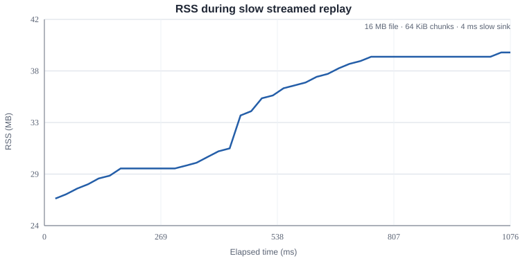

# JavaScript Semester Project — Space Arena

## Lab 04 — Node.js: EventEmitter, streams, HTTP and WebSocket

This laboratory continues the same Space Arena project from Labs 01–03. The browser client stays in `client/`; the new Node.js server lives in `server/`.

### What was added in Lab 04

- Node.js HTTP server built with `node:http`.
- ESM server modules plus a small CommonJS interoperability example.
- `Room extends EventEmitter` with handled `error` events.
- Room storage and cleanup on the server; an empty room is deleted after the last player leaves.
- `GET /health`, `GET /api/rooms`, `POST /api/rooms` and streamed replay `GET /api/rooms/:id/replay`.
- Static serving of `client/dist` with traversal protection against `..` path segments.
- Environment configuration in `server/src/config.js`: `PORT`, `LOG_DIR`, `CLIENT_DIST_DIR`, `WS_MAX_PAYLOAD`, `MAX_MESSAGES_PER_SECOND`.
- Graceful `SIGINT`/`SIGTERM`: WebSocket clients close, HTTP server stops accepting new requests, room logs are flushed, exit code is 0.
- WebSocket endpoint `/ws` using the `ws` package.
- Message validation: unknown type, malformed data and oversized payloads cause a policy/size close.
- Join must arrive within 5 seconds.
- Server heartbeat: ping every 15 seconds; two missed pong responses cause disconnect.
- Message rate limiting per socket.
- Server-side backpressure guard using `ws.bufferedAmount`; non-critical messages are skipped for a congested client.
- Client `ReconnectingSocket` wrapper with an outgoing queue and exponential reconnect delay with jitter.
- Match logging with a `Readable -> Transform -> file` pipeline. Events become NDJSON without building the whole log in memory.
- Replay uses `createReadStream()` and the same streaming model; the log file is not loaded into RAM as one large string.
- The existing Lab 03 lobby now receives its room list from the Node server through the Vite proxy. The player can join and use room chat. Ship coordinates are still local; networking is intentionally postponed to Lab 05.

## Project structure

```text
.
├── client/
│   ├── public/
│   │   └── assets/
│   ├── src/
│   ├── index.html
│   ├── vite.config.js
│   └── package.json
├── server/
│   ├── bench/
│   │   └── rss-backpressure.mjs
│   ├── data/
│   │   └── rooms.json
│   ├── examples/
│   │   └── commonjs-demo.cjs
│   ├── src/
│   │   ├── config.js
│   │   ├── http.js
│   │   ├── index.js
│   │   ├── match-log.js
│   │   ├── protocol.js
│   │   ├── request.js
│   │   ├── rooms.js
│   │   └── ws-server.js
│   └── package.json
├── docs/
│   └── rss-backpressure.svg
├── .env.example
├── eslint.config.js
├── package.json
└── README.md
```

## npm workspaces and commands

The root `package.json` uses npm workspaces:

```json
"workspaces": ["client", "server"]
```

Install everything from the repository root:

```bash
npm install
```

Development starts Vite and the Node server together:

```bash
npm run dev
```

The Vite development server is `http://localhost:5173/`. Its `/api` and `/ws` routes are proxied to the Node server on port 3000.

Build the browser client:

```bash
npm run build
```

Start the production Node server after the client build:

```bash
npm start
```

Run lint:

```bash
npm run lint
```

## Node.js and environment configuration

The server uses ESM (`"type": "module"`). Node can also load CommonJS with `createRequire()`; `server/examples/commonjs-demo.cjs` is loaded by `server/src/index.js` as the interoperability demonstration.

Configuration is read and validated in `server/src/config.js`:

```text
PORT=3000
SERVER_PORT=3000
LOG_DIR=./server/logs
CLIENT_DIST_DIR=./client/dist
WS_MAX_PAYLOAD=16384
MAX_MESSAGES_PER_SECOND=12
```

Invalid numeric values cause the server to fail early instead of starting with an invalid configuration.

`node:http` body handling uses `Buffer.concat()` with a maximum request-body size. Static files are resolved against the build directory and requests containing a `..` path segment are rejected.

## libuv event-loop note

The Node event loop is built around libuv. The important phases to recognize for this lab are timers, pending callbacks, poll, check and close callbacks. `setImmediate()` runs in the check phase, while timer callbacks become eligible in the timers phase; exact ordering also depends on what is currently in the poll queue.

## HTTP API

### `GET /health`

Returns a small JSON health object.

### `GET /api/rooms`

Returns current room summaries. The Lab 03 lobby polls this endpoint only while the lobby is visible; each request gets an `AbortSignal.timeout()` on the browser side.

You can verify the API manually from a terminal: `curl.exe http://localhost:3000/health` and `curl.exe -X POST http://localhost:3000/api/rooms -H "Content-Type: application/json" -d "{\"id\":\"training\",\"name\":\"Training Room\"}"`.

### `POST /api/rooms`

Creates a room from JSON configuration, for example:

```json
{
  "id": "training",
  "name": "Training Room",
  "maxPlayers": 4,
  "width": 960,
  "height": 540,
  "asteroids": 6,
  "enemies": 1
}
```

### `GET /api/rooms/:id/replay`

Streams the room's NDJSON match log. The server uses a read stream rather than reading the complete file into memory.

## Room and WebSocket model

`Room` extends Node's `EventEmitter`. It emits `joined`, `left`, `chat`, `closed`, and can safely emit `error` because an error listener is installed.

The WebSocket protocol currently contains only:

```text
join  { type: "join", roomId, playerName }
leave { type: "leave" }
chat  { type: "chat", message }
```

Coordinates are deliberately not sent yet; that is the Lab 05 task.

The server validates every incoming message before using it. Unknown message types, broken forms and oversized data are rejected. A new socket has 5 seconds to join a room. Each socket is rate-limited to `MAX_MESSAGES_PER_SECOND` messages.

Heartbeat logic follows the usual `ws` ping/pong pattern. The server sends ping frames every 15 seconds. If two consecutive heartbeat checks receive no pong, the socket is terminated.

On the client, `ReconnectingSocket` keeps outbound messages in a bounded queue and reconnects with an exponential delay plus jitter after an unexpected close.

For backpressure, broadcasts check `ws.bufferedAmount`. When it is above 64 KiB, non-critical messages are skipped for that congested socket instead of allowing an ever-growing application-level queue.

## Match log stream

A room log is built as a Node stream pipeline:

```text
Room event object
      ↓
Readable (event source)
      ↓
Transform (object → NDJSON line)
      ↓
createWriteStream()
      ↓
server/logs/<room-id>.ndjson
```

The important property is that the pipeline propagates backpressure. The producer does not need to keep a giant in-memory string containing the whole replay.

Replay uses:

```text
createReadStream(log)
      ↓
HTTP response
```

so the large log is streamed to the client instead of loaded into memory at once.

## RSS / backpressure measurement

The benchmark `server/bench/rss-backpressure.mjs` creates a temporary 16 MB NDJSON-like file and sends it through a deliberately slow `Writable` using a 64 KiB read buffer. During the transfer it samples `process.memoryUsage().rss` and generates:

- `server/bench/rss-measurement.csv`
- `docs/rss-backpressure.svg`

Run it from the repository root:

```bash
npm run bench:memory
```

A reference run in the prepared workspace consumed the full 16 MB stream with 43 samples. RSS ranged from 26.36 MB to 39.11 MB (12.75 MB warm-up delta). The curve is bounded rather than increasing with every byte of the replay file, which is the expected streaming/backpressure behavior. Exact values vary by Node version, OS and machine.



## Short note: event loop, 300 ms HTTP handler and `error`

Node.js runs JavaScript handlers on its main event-loop thread. A synchronous HTTP handler that burns 300 ms of CPU does not only delay its own response: it also delays other callbacks that are ready to run on that same event loop. The fix is to avoid long synchronous work in request handlers and move CPU-heavy work to a worker/threaded design when necessary.

An `EventEmitter` has a special `error` event. If an emitter emits `error` and there is no registered `error` listener, Node treats it as an unhandled error and the process can terminate. In this project `Room` and the room manager install explicit `error` listeners so an emitted error is observed instead of becoming an unhandled process-level failure.

## Lab 04 verification checklist

- [x] `client/` and `server/` split.
- [x] Node server serves the built client.
- [x] `..` static-path traversal is rejected.
- [x] `GET /api/rooms`, `POST /api/rooms`, `GET /health`.
- [x] Vite `/api` and `/ws` proxy in development.
- [x] Environment configuration and validation.
- [x] Graceful shutdown on SIGINT/SIGTERM.
- [x] `Room extends EventEmitter` and handled `error` event.
- [x] WebSocket validation, join timeout, ping/pong, rate limit.
- [x] Server-side `bufferedAmount` guard.
- [x] Client queued send + reconnect with increasing delay.
- [x] NDJSON match log through a stream pipeline.
- [x] Replay through `createReadStream()`.
- [x] RSS/backpressure graph included.

## Previous labs

Lab 01 added the fixed-step `requestAnimationFrame` loop, accumulator/interpolation, keyboard closure and Canvas rendering.

Lab 02 added `Vector2`, `Entity`, `Ship extends Entity`, `World` with `Map`, collision handling, projectiles, asteroids, private HP, `this` fixes, prototype inspection and composition-based homing/pickups.

Lab 03 added asynchronous asset loading with retries and `AbortSignal`, loading progress, Web Audio, `EventTarget` events, the lobby, Promise combinator experiments, microtask puzzles and failure handling.

## Submission

The same public GitHub repository is used for all semester labs. For this laboratory create and push the `lab-04` tag after the final commit:

```bash
git add .
git commit -m "lab-04: Node server, streams and WebSocket"
git push origin main
git tag lab-04
git push origin lab-04
```
